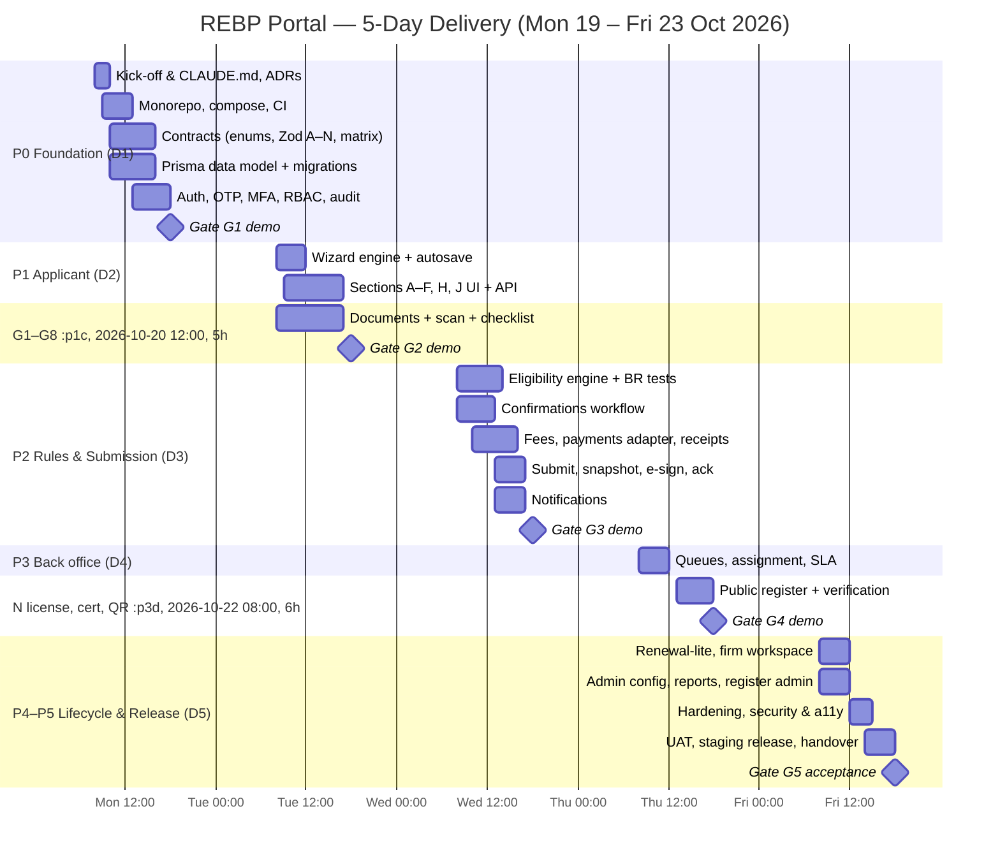

# Implementation Plan — REBP Portal (5-Day, Claude Code–Assisted Delivery)

| Item | Value |
|---|---|
| Document ID | REBP-PORTAL-PLAN-001 |
| Version | 1.0 |
| Date | 2026-10-14 |
| Baseline | [SRS REBP-PORTAL-SRS-001 v1.0](SRS.md) |
| Delivery window | 5 working days: **Mon 19 Oct – Fri 23 Oct 2026** (D1–D5) |
| Delivery model | A small team, each engineer driving Claude Code (AI pair-programming agent) in parallel tracks |
| Prepared by | Project Management Office (PMO) |
| Status | Draft for sponsor approval |

---

## 1. Executive summary

The SRS describes a national-grade licensing platform. Its own phasing (SRS §18) estimates **36–48 weeks** of conventional delivery, including integrations with government systems, penetration testing, a DPIA and usability research.

This plan delivers a **working, demonstrable, production-architected Release 1 ("Pilot MVP")** in **5 days**. It gets there by:

1. **Compressing build effort with Claude Code.** Scaffolding, CRUD, schema-driven forms, tests and documentation are generated by the agent and reviewed by engineers.
2. **Running three parallel tracks**, each in its own git worktree with its own Claude Code session, kept in sync through a shared contract package (types, Zod schemas, rules).
3. **Ruthless scope control.** The full end-to-end licensing loop (apply → pay → confirm → review → decide → license → public register) is built for **all 8 categories** and the **"New registration"** application type. **Renewal** is built in reduced form. Everything that depends on third parties, legal sign-off or calendar time is behind **adapters with mocks**, or in the post-pilot backlog.

**What the sponsor gets on Friday 23 October:** a deployed staging environment, a recorded end-to-end demo, about 70% of SRS "Must" functional requirements implemented and traced, an automated test suite, and a costed backlog for Release 2 and Release 3.

**What the sponsor does not get in 5 days, and why:** live government integrations (data-sharing agreements needed), legally approved translations, a penetration test, a DPIA, migration of legacy data (the data has not been provided), and a go-live to the public. These follow the pilot, as set out in §11.

> **PM position:** 5 days is achievable for a *pilot-grade* release only if the pre-start inputs in §4 are delivered and the scope boundary in §3 is held. Any scope addition during the week must be traded against an item of equal size (§13 change control).

---

## 2. Objectives and success criteria

| # | Objective | Measure of success (verified Fri D5) |
|---|---|---|
| O1 | Prove the end-to-end licensing loop | An FSLA and an REBF application go from account creation to a public register entry on staging, with no manual DB edits |
| O2 | Cover all eight categories | Each category's wizard renders only its applicable sections (SRS FR-WIZ-003) and passes an E2E happy-path test |
| O3 | Make the eligibility rules executable | 100% of rules BR-001…BR-102 that are in scope are implemented as configurable rules, each with table-driven tests |
| O4 | Lay a regulator-grade foundation | Audit trail, RBAC, segregation of duties, encrypted sensitive fields and malware-scanned uploads in place |
| O5 | Produce a deployable, maintainable codebase | CI green; ≥ 70% coverage on domain modules; Infrastructure-as-Code compose stack; runbook and README |
| O6 | Give the sponsor transparency | Daily demos, a traceability matrix (SRS ID → code → test) and a backlog for R2/R3 |

---

## 3. Scope

### 3.1 Scope strategy

The SRS's ~400 requirements are grouped into **20 capability epics (E01–E20)**. Each epic gets a 5-day disposition:

- **BUILD** — fully implemented and tested.
- **BUILD-LITE** — implemented for the core path, with simplifications noted.
- **ADAPTER** — the interface is built against a mock or sandbox, and the real provider is plugged in later with no domain change.
- **DEFER** — moved to the post-pilot backlog.

### 3.2 Epic disposition

| Epic | Capability | SRS refs | 5-day disposition | Notes / simplification |
|---|---|---|---|---|
| E01 | Platform foundation (monorepo, CI, envs, design system) | §16, NFR-MNT | **BUILD** | Docker Compose stack; cloud IaC deferred |
| E02 | Accounts, verification, MFA, sessions | FR-ACC-001…010 | **BUILD** | Passkeys (005) and national SSO (006) **DEFER** |
| E03 | RBAC / ABAC, staff roles | SEC-004, App. D | **BUILD** | Region scoping is LITE |
| E04 | Application wizard engine (schema-driven, conditional, autosave) | FR-WIZ-001…014 | **BUILD** | Offline cache (011) **DEFER** |
| E05 | Sections A–F, H, J (individual) | FR-A…FR-J | **BUILD** | Map pin (B-012), OCR **DEFER** |
| E06 | Section G1–G8 category requirements | FR-G1…FR-G8 | **BUILD** | Committee items deferred |
| E07 | Eligibility engine + business rules | §9.1, §10 | **BUILD** | Rule simulator (ELG-005) **DEFER** |
| E08 | Documents (upload, scan, versioning, checklist) | FR-DOC, FR-I | **BUILD-LITE** | Resumable tus upload is LITE (chunked multipart); OCR and document wallet **DEFER** |
| E09 | Supervisor / Principal Broker confirmations | FR-F-007, FR-FIRM-003 | **BUILD** | Bulk confirm is LITE |
| E10 | Fees and payments | FR-PAY-001…014 | **ADAPTER** | Mock gateway + one mobile-money sandbox adapter *if* credentials arrive by D2; reconciliation is LITE; refunds are maker-checker records only |
| E11 | Back-office queues and Section L review | FR-BO, FR-L | **BUILD** | Specialist-referral queue LITE |
| E12 | Section M decision + segregation of duties | FR-M-001…017 | **BUILD** | Committee decision (014) and batch approval (016) **DEFER** |
| E13 | Section N license, certificate PDF + QR, register projection | FR-N-001…012 | **BUILD-LITE** | Self-signed seal in pilot; PAdES with an accredited CA **DEFER**; wallet pass and physical card **DEFER** |
| E14 | Public register and verification page | FR-REG-001…008 | **BUILD** | Partner API (006) **DEFER** |
| E15 | Notifications (email, SMS, in-app) | FR-NOT, App. C | **ADAPTER** | Email via SMTP (Mailpit in dev); SMS via mock adapter; WhatsApp and push **DEFER** |
| E16 | Audit trail (append-only, hash-chained) | FR-AUD-001…005 | **BUILD** | WORM storage deferred; hash chain in DB |
| E17 | Renewal, upgrade, change of affiliation, reinstatement | §9.4, FR-F-010, BR-100…102 | **BUILD-LITE** | **Renewal** built (pre-fill, reminders job, grace and lapse). Upgrade, change of affiliation and reinstatement reuse the wizard but are **R2** |
| E18 | Firm workspace (roster, branches, end affiliation) | FR-FIRM-001…012 | **BUILD-LITE** | Roster + confirmation inbox; branch change requests **R2** |
| E19 | Admin configuration (fees, rules, checklist, templates) | FR-ADM-001…005 | **BUILD-LITE** | Versioned JSON config with seed + admin edit for fees and thresholds; full maker-checker UI **R2** |
| E20 | Reporting, register administration, DSAR | FR-RPT, FR-RA, FR-DSR | **BUILD-LITE** | Operational dashboard + CSV export; suspend and revoke actions; DSAR export of own data. Legacy migration **DEFER** |
| — | External gov. integrations (NIDA, RDB, RRA, police, education, exam bodies) | INT-001…006 | **ADAPTER/DEFER** | Interface + mock only; manual verification is the baseline (as the SRS allows) |
| — | i18n (EN/RW/FR) | UX-003 | **BUILD-LITE** | All strings externalised; EN complete; RW/FR machine drafts **flagged "unapproved"** |
| — | Accessibility | UX-002 | **BUILD-LITE** | axe automated checks in CI + a manual keyboard pass; formal audit **DEFER** |

### 3.3 Explicitly out of scope for this 5-day window

Pen-test and DPIA execution, legal approval of declaration and translation texts, production go-live, real payment settlement, legacy register migration, usability testing with real users, CPD, complaints and discipline case management, native apps, and land registry integration. Each is assigned to a release in §11.

---

## 4. Pre-start inputs (must be received by Fri 16 Oct, 17:00)

Missing inputs do **not** stop the project. The default decision in the right-hand column is applied automatically and logged as an assumption for later confirmation.

| # | Input needed | From | SRS ref | Default if not received |
|---|---|---|---|---|
| P1 | Sponsor sign-off of this plan and the scope boundary | Sponsor | — | **Blocking.** The project does not start |
| P2 | Named SME from the Professional Body, available 2 h/day for decisions and UAT | Sponsor | — | **Blocking.** PM acts as proxy SME, which carries a high risk of rework |
| P3 | Fee schedule (amounts per category × type) | Finance | Q-02 | Placeholder fees, clearly marked "SAMPLE" |
| P4 | Final declaration text, code of conduct, Article 10 text | Legal | AS-06 | Form REBP–REG–01 wording, verbatim |
| P5 | Administrative divisions dataset (Province → Village) | ICT | C-08 | Open dataset subset for 2 provinces, with the import script ready for the full set |
| P6 | Mobile-money / gateway sandbox credentials | Finance/ICT | Q-12 | Mock gateway only |
| P7 | Hosting target for staging (cloud account or VM) | ICT | Q-18 | Team-managed cloud VM, non-production data only |
| P8 | Logo, brand colours, official name | Comms | Q-01 | Neutral design-system theme |
| P9 | Decisions on Q-03 (RERA experience), Q-06 (multi-affiliation), Q-17 (criminal record validity) | SME | §17 | SRS defaults (BR-020 FSLA only; one affiliation; 6 months) |
| P10 | GitHub organisation/repo access, Claude Code licences/seats | ICT | — | **Blocking** |

---

## 5. Team, roles and the Claude Code operating model

### 5.1 Team (minimum viable)

| Role | Allocation | Responsibilities |
|---|---|---|
| **Project Manager / BA** (plan owner) | 100% | Scope control, daily stand-up and demo, decisions log, risk register, UAT coordination, traceability |
| **Tech Lead / Senior Full-Stack** | 100% | Architecture, shared contracts, Track A (backend/domain) lead, code-review gate, merges |
| **Full-Stack Engineer #2** | 100% | Track B (applicant and back-office UI) lead |
| **QA / DevOps Engineer** | 100% (D1–D5) | Track C: CI/CD, environments, test automation, security scans, deployment |
| **Professional Body SME** | 2 h/day | Rule clarification, UAT sign-off, content approval |
| **Sponsor** | 30 min/day | Daily demo, go/no-go at each gate |

> **Solo-developer contingency:** if only one engineer is available, the plan keeps the same day structure. Track C work is absorbed by Claude Code background agents, and the scope drops to: individual categories only (REBF/G8 → R2), mock payments only, no renewal. This is about 45% of the "Must" requirements instead of about 70%.

### 5.2 Claude Code operating model

| Practice | How it is applied |
|---|---|
| **Project memory** | A root `CLAUDE.md` (written D1 AM) holds the architecture, coding conventions, folder map, "never do" rules (no PII in logs, no direct DB writes outside repositories, all strings via i18n) and the commands to run lint, tests and the dev stack. Each app has its own `CLAUDE.md`. |
| **SRS as the source of truth** | Every task prompt cites SRS requirement IDs, e.g. *"Implement FR-L-003…FR-L-006; acceptance per SRS §19.2"*. Commits reference the IDs (`feat(review): FR-L-003 verification checklist`). |
| **Parallel tracks via git worktrees** | `wt-backend`, `wt-frontend` and `wt-platform`, one Claude Code session each, integrating into `main` through short-lived PRs at least twice a day. |
| **Contract-first** | `packages/contracts` (Zod schemas, enums, API types and rule definitions) is built first on D1. Backend and frontend agents build against it, which prevents drift between parallel sessions. |
| **Plan → implement → verify loop** | For each work package: (1) Claude Code produces a plan, (2) the engineer approves or adjusts it, (3) the agent implements with tests, (4) the agent runs lint, type-check and tests, (5) the engineer reviews the diff. |
| **Subagents** | Used for repo-wide exploration, generating test matrices from the BR catalogue, and documentation. Not used for architecture decisions. |
| **Quality gates** | Hooks run format, lint and type-check after edits; `/code-review` on every PR; `/security-review` on auth, documents, payments and the audit trail before merge. |
| **Human-only decisions** | Architecture, security-sensitive merges (auth, crypto, RBAC), legal text, rule interpretation, production deployment. |
| **Guardrails** | No secrets in prompts or repo; `.env.example` only; agents run with project-scoped permissions; no production data in development. |

### 5.3 RACI (key deliverables)

| Deliverable | PM | Tech Lead | Eng #2 | QA/DevOps | SME | Sponsor |
|---|---|---|---|---|---|---|
| Scope and plan | **A/R** | C | I | I | C | A (approve) |
| Architecture and contracts | C | **A/R** | C | C | I | I |
| Backend domain modules | I | **A** | C | C | C | I |
| Applicant and back-office UI | I | A | **R** | C | C | I |
| Eligibility rules | C | **A/R** | I | C (tests) | **C (validate)** | I |
| CI/CD, environments | I | A | I | **R** | I | I |
| Test automation | I | A | C | **R** | I | I |
| UAT and acceptance | **R** | C | C | C | **A** | I |
| Go/no-go gates | **R** | C | I | C | C | **A** |

---

## 6. Solution approach for the 5-day build

### 6.1 Technology (aligned with SRS §16, adjusted for speed)

| Layer | Choice | 5-day rationale |
|---|---|---|
| Monorepo | pnpm workspaces + Turborepo | One repo, shared contracts, cached builds |
| Web | Next.js 15 (App Router), React, TypeScript, Tailwind, shadcn/ui, React Hook Form + Zod, TanStack Query, next-intl | Fast, accessible components that Claude Code generates reliably |
| API | NestJS (TypeScript), OpenAPI via Swagger, class-validator via Zod pipes | Module boundaries match SRS epics; guards for RBAC |
| Data | PostgreSQL 16 + Prisma; JSONB section data with schema versions | Matches SRS DATA-001 |
| Jobs | Redis + BullMQ | Notifications, scans, PDF generation, reminders |
| Files | MinIO (S3 API) + ClamAV sidecar + sharp | Local parity with cloud S3 |
| PDF | Playwright HTML-to-PDF (certificates, receipts, letters) + `qrcode` | Fast to template |
| Auth | Session-based auth in the API (argon2id, TOTP via otplib, OTP via the notification adapter) | Avoids standing up an IdP in 5 days; Keycloak/OIDC is an R2 option (ADR-004) |
| Rules | `json-rules-engine` with typed rule definitions in `packages/contracts` | Configurable, testable, shared by wizard and API |
| Testing | Vitest (unit), Supertest (API), Playwright (E2E), axe-core | One toolchain |
| CI/CD | GitHub Actions: lint → type-check → test → build → container scan → deploy to staging | |
| Runtime | Docker Compose for dev and staging; Terraform/K8s in R2 | |

### 6.2 Repository structure (created on D1)

```
rebp-portal/
├── CLAUDE.md
├── apps/
│   ├── web/                 # Next.js: public site, applicant portal, firm workspace, back office
│   └── api/                 # NestJS: domain modules
│       └── src/modules/{identity,rbac,applications,wizard,eligibility,documents,
│                        confirmations,payments,review,decisions,licensing,register,
│                        firms,notifications,audit,admin,reports}
├── packages/
│   ├── contracts/           # Zod schemas (sections A–N, G1–G8), enums, API DTOs, rule defs
│   ├── rules/               # Eligibility engine wrapper + BR catalogue + tests
│   ├── ui/                  # Shared design-system components
│   └── config/              # eslint, tsconfig, tailwind presets
├── infra/
│   ├── docker-compose.yml   # postgres, redis, minio, clamav, mailpit
│   └── seed/                # admin divisions, categories, fees, checklist matrix, demo users
├── docs/                    # SRS.md, IMPLEMENTATION_PLAN.md, ADRs, runbook
└── .github/workflows/
```

### 6.3 Architectural decisions to record on D1 (ADRs)

| ADR | Decision |
|---|---|
| ADR-001 | Modular monolith (NestJS) + separate Next.js front end in one monorepo |
| ADR-002 | Schema-driven wizard: one Zod schema per section, plus a **visibility matrix** (category × type) in `contracts` that drives both UI rendering and server validation |
| ADR-003 | Explicit application and license state machines in the domain layer; every transition writes an audit event |
| ADR-004 | Session auth built in for the pilot; OIDC IdP (Keycloak) in R2 |
| ADR-005 | Adapter pattern for every external system (payment, SMS, ID, company registry, e-seal), with mock implementations |
| ADR-006 | Register is a read-model projection, refreshed by a domain event on license change |
| ADR-007 | Audit log is an append-only table with a SHA-256 hash chain; DB role without UPDATE/DELETE |

---

## 7. Phase structure and day mapping

Six delivery phases are grouped into 5 days. Each day ends with a **demo and a quality gate**.

| Phase | Name | Day | Theme | Exit gate |
|---|---|---|---|---|
| **P0** | Mobilise & Foundation | **D1** (Mon 19 Oct) | Repo, contracts, data model, auth, RBAC, audit, CI | **G1 — Foundation ready** |
| **P1** | Applicant Experience | **D2** (Tue 20 Oct) | Wizard engine, Sections A–J, G1–G8, documents, checklist | **G2 — Application can be drafted end-to-end** |
| **P2** | Rules, Confirmation & Submission | **D3** (Wed 21 Oct) | Eligibility engine, confirmations, fees and payments, submission, notifications | **G3 — Application can be submitted** |
| **P3** | Regulator Back Office | **D4** (Thu 22 Oct) | Queues, Section L review, Section M decision, Section N license and register | **G4 — License can be issued and verified publicly** |
| **P4** | Lifecycle & Administration | **D5 AM** (Fri 23 Oct) | Renewal-lite, firm workspace, admin config, reports, register admin | — |
| **P5** | Harden, Release & Handover | **D5 PM** (Fri 23 Oct) | Security, accessibility, performance, UAT, staging release, handover | **G5 — Pilot accepted** |



**Daily rhythm (all days):**

| Time | Activity |
|---|---|
| 08:00–08:15 | Stand-up: yesterday, today, blockers, decisions needed from the SME |
| 08:15–12:30 | Build block 1 (parallel tracks) |
| 12:30 | Integration checkpoint: merge to `main`, CI green, deploy to dev |
| 13:30–17:00 | Build block 2 |
| 16:00–16:30 | SME decision window (rules, content) |
| 17:00–17:30 | Integration, regression run, staging deploy |
| 17:30–18:00 | **Demo + gate review** with sponsor and SME; next-day scope confirmation |
| 18:00 | PM publishes the daily status report (§12.2) |

---

## 8. Detailed day-by-day plan

Notation: **WP** = work package. **Track A** = backend/domain (Tech Lead), **Track B** = front end (Eng #2), **Track C** = platform/QA (QA/DevOps). Every WP is executed with Claude Code using the plan → implement → verify loop (§5.2).

---

### Day 1 (Mon 19 Oct) — Phase P0: Mobilise & Foundation

**Goal:** A running skeleton that every later feature plugs into. The contracts and data model are frozen enough to allow parallel work from D2.

| WP | Track | Work package | SRS refs | Deliverables | Acceptance criteria |
|---|---|---|---|---|---|
| WP-0.1 | PM | Kick-off (45 min): goals, scope boundary, RACI, gates, decision log opened; confirm P3–P9 inputs | §1, §17 | Kick-off notes; decision log; risk register v1 | Sponsor and SME attend; scope boundary acknowledged in writing |
| WP-0.2 | A | `CLAUDE.md` (root + per app), ADR-001…007, conventions | §16 | `CLAUDE.md`, `docs/adr/*` | Reviewed by Tech Lead; agents follow conventions in first PRs |
| WP-0.3 | C | Monorepo scaffold (pnpm, Turborepo, Next.js, NestJS, shared configs), Docker Compose (postgres, redis, minio, clamav, mailpit), `.env.example` | NFR-MNT-001/004 | Running `pnpm dev` stack | Fresh clone → `pnpm i && pnpm dev` works in < 10 min |
| WP-0.4 | C | CI pipeline: lint, type-check, unit tests, build, dependency audit, container scan; branch protection | NFR-MNT-003 | `.github/workflows/ci.yml` | PR fails on lint, type or test error |
| WP-0.5 | A | **Contracts package:** enums (application types, categories, statuses, document types), Zod schemas for Sections A–N and G1–G8 from SRS App. A, the **visibility matrix** (category × type → sections and fields) and the **checklist matrix** (SRS App. B) | App. A, App. B, §3.2, §3.3, FR-DOM-001 | `packages/contracts` | Unit tests assert the visibility matrix for all 8 categories × 6 types; the matrix matches SRS §3.2/§3.3 |
| WP-0.6 | A | **Prisma data model** for SRS §12.1 core entities (account, person, address, admin_division, qualification, training, exam_result, experience_record, firm, branch, firm_membership, application, section_data, snapshot, document(+version), eligibility_result, confirmation_request, affiliation, payment, fee_schedule, review, information_request, decision, license(+history), register_entry, notification, audit_event, config_*); migrations; field encryption helper and blind index | §12, DATA-001…005, SEC-003 | Migrations, seed script | `prisma migrate` clean; seed loads categories, sample admin divisions, sample fees, demo staff users |
| WP-0.7 | A | **Identity:** sign-up (individual and organisation), email link and SMS OTP verification (mock SMS adapter), argon2id passwords, TOTP MFA (mandatory for staff), sessions with idle and absolute timeouts, lockout and rate limits, duplicate-identity guard | FR-ACC-001…004, 007, 008, 010, SEC-005/006 | `identity` module + UI pages | E2E: sign-up → verify email + phone → sign-in → MFA enrolment works; a duplicate NID is blocked |
| WP-0.8 | A | **RBAC:** roles from SRS App. D, Nest guards, permission decorators, assignment-scoped access helper | SEC-004, App. D | `rbac` module | Unit tests for each role × capability in App. D (core rows) |
| WP-0.9 | A | **Audit trail:** append-only table, hash chain, interceptor capturing actor, action, entity, diff (PII masked), IP, user agent and correlation ID; restricted DB role | FR-AUD-001…003, ADR-007 | `audit` module | Tamper test: editing a row breaks chain verification |
| WP-0.10 | B | **Design system and app shell:** Tailwind tokens, shadcn/ui, layout for public / applicant / firm / back office, i18n scaffold (EN complete; RW/FR keys), accessible form primitives (field, error summary, file upload, address cascade), landing page | UX-001…009, UX-003 | `packages/ui`, app shell | axe: 0 serious violations on shell pages; language switcher works |
| WP-0.11 | B | Auth UI: sign-up, verify, sign-in, MFA, recovery, account security page | FR-ACC | Pages | Keyboard-only completion possible |

**End-of-day gate G1 — Foundation ready**

- [ ] Stack runs locally and in CI; first staging deploy done (even if it only shows the shell).
- [ ] Contracts and DB schema merged; **schema freeze** for D2 (changes after this go through the Tech Lead).
- [ ] A user can register, verify, sign in with MFA; staff roles seeded.
- [ ] Audit events recorded for auth actions.

**Claude Code focus D1:** heavy scaffolding and boilerplate generation; translating SRS Appendix A into Zod schemas and Appendix B into a matrix (high leverage, with mandatory human review of the matrix against the SRS).

---

### Day 2 (Tue 20 Oct) — Phase P1: Applicant Experience

**Goal:** An applicant of **any of the 8 categories** can create and complete a draft with documents, seeing only the sections that apply to them.

| WP | Track | Work package | SRS refs | Deliverables | Acceptance criteria |
|---|---|---|---|---|---|
| WP-1.1 | A | **Applications module:** create draft (reference number with check digit, FR-A-001), type and category validation per matrix, section save API (per-section schema validation), autosave endpoint, state machine skeleton (DRAFT, WITHDRAWN), withdraw | FR-A-001…006, FR-WIZ-004, FR-WF-001/002/005 | API + tests | Invalid type × category combination rejected with an explanation; reference format correct |
| WP-1.2 | B | **Wizard engine:** step generation from the visibility matrix, step navigator with completion states, debounced autosave (≤ 2 s), resume, inline validation, error summary, help panel, warn-and-preserve on category change | FR-WIZ-001…006, 009, 012, UX-004/005 | Wizard framework | Switching category hides and preserves data; reload resumes at the last step |
| WP-1.3 | B | **Section A** (type and category cards with key requirements) and **Section B** (structured name, ID types, DOB, nationality, gender behind a feature flag, phone and email pre-filled, address cascade Province→Village, same-as toggle, occupation, employer, photo with crop and guidance, proof of ID) | FR-A-003…007, FR-B-001…011, 013…016 | UI + API wiring | Address cascade loads from seed; the gender field is hidden when the flag is off |
| WP-1.4 | B | **Section C** (repeatable qualifications, highest level, foreign-qualification branch) and **Section D** (training Y/N branch, providers and programmes lookup, exam Y/N/NA by category) | FR-C-001…006, FR-D-001…005, 008 | UI | "Foreign = Yes" makes the recognition evidence required; exam "Not applicable" only offered where allowed |
| WP-1.5 | B | **Section E** (experience records, computed total, REA/Broker extra items E.9–13, equivalence branch) with an **experience timeline** visual | FR-E-001…006, 008 | UI | Items E.9–13 visible only for REA/Broker |
| WP-1.6 | A+B | **Section F** (affiliation; firm typeahead from register, auto-fill of firm and Principal Broker details; supervisor lookup; RERA referral arrangement branch; independent Broker branch) | FR-F-001…006, 008, 009 | API lookups + UI | Selecting a firm auto-fills F.3–F.6 |
| WP-1.7 | B | **Section G1–G8:** render only the applicable subsection; reuse B–F data as confirmations; category-unique fields (territory multi-select, acknowledgments with versioned text, practice arrangement, Associate/Managing/Principal items, REBF corporate data with directors, branches and the corporate document set) | FR-G-000, FR-G1…FR-G8 | 8 sub-forms | E2E smoke: each category shows exactly its G-subsection |
| WP-1.8 | B | **Section H** (four integrity questions, conditional disclosure details, criminal record certificate with issue date, code-of-conduct Y/N) | FR-H-001…005 | UI | "No" to H.7 shows a blocking message |
| WP-1.9 | A | **Documents service:** upload API (multipart chunked), MIME sniffing, size limits per type, PDF active-content rejection, ClamAV scan job via BullMQ, quarantine, versioning, signed URLs, encryption at rest (MinIO SSE), expiry dates | FR-DOC-001…004, 006…008, 011, SEC-008 | `documents` module | EICAR test file quarantined; a mismatched extension is rejected; a replaced document keeps its prior version |
| WP-1.10 | B | **Upload UX + dynamic checklist (Section I):** camera capture on mobile, client compression, multi-image → PDF, progress, scan status, checklist panel with statuses | FR-I-001…004, FR-DOC-005, UX-007 | Components | Checklist changes when a conditional answer changes (e.g. foreign qualification) |
| WP-1.11 | C | E2E test harness (Playwright), test data factories, per-category draft smoke tests; staging deploy automation | NFR-MNT-002 | Tests + pipeline | 8 category draft smokes green in CI |

**End-of-day gate G2 — Application can be drafted end-to-end**

- [ ] For each of the 8 categories, a draft can be completed through to the review step.
- [ ] Uploads are scanned; the checklist is dynamic and correct per SRS App. B (SME spot-checks 3 categories).
- [ ] Autosave and resume demonstrated on mobile viewport.

**Claude Code focus D2:** high-volume UI generation from the contracts schemas. Engineers concentrate their review on conditional logic and accessibility.

---

### Day 3 (Wed 21 Oct) — Phase P2: Rules, Confirmation & Submission

**Goal:** A complete draft can be checked for eligibility, signed, paid and submitted. Supervisor and Principal confirmation runs, and the applicant receives an acknowledgment.

| WP | Track | Work package | SRS refs | Deliverables | Acceptance criteria |
|---|---|---|---|---|---|
| WP-2.1 | A | **Eligibility engine:** typed rule definitions for BR-001…BR-102 (in-scope set), outcomes PASS/FAIL/WARN/NEEDS_ASSESSMENT with i18n messages and evidence, rule versioning, run contexts (LIVE, SUBMIT, REVIEW), **eligible-from projection**, experience merge and overlap logic, suspension exclusion | §9.1 FR-ELG-001…004, §10 | `packages/rules`, `eligibility` module | **Table-driven tests for every in-scope BR** (target ≥ 150 cases, generated with Claude Code from the SRS catalogue and reviewed by the SME) |
| WP-2.2 | B | Live eligibility feedback in the wizard (non-blocking banners and an eligibility panel) + the public **"Am I eligible?"** pre-check page | FR-WIZ-007, FR-PORTAL-006 | UI | SRS §19.2 scenarios "Under-age blocked" and "REA eligible-from" pass |
| WP-2.3 | A | **Confirmations workflow:** create supervisor and Principal requests on submit; addressee inbox API; confirm or decline with reason; expiry and reminders (BullMQ delayed jobs); officer override with reason; supervisor validity check (BR-030/031) | FR-F-007, §4.3, BR-030, BR-031, FR-WF-006 | `confirmations` module | Application stays PENDING_CONFIRMATIONS until all mandatory confirmations arrive; a decline → ACTION_REQUIRED |
| WP-2.4 | B | **Confirmation inbox UI** (supervisor and Principal Broker) with request detail and confirm/decline, plus bulk confirm for Principal Brokers | FR-FIRM-003 | UI | Principal Broker confirms 3 requests in one action |
| WP-2.5 | A | **Fees and payments:** fee schedule (versioned, seeded), calculator (category × type × applicant type × timing), itemised breakdown, payment reference, **gateway adapter interface** + mock provider (success, failure and delayed webhooks) + mobile-money sandbox adapter if P6 received; idempotent webhook handler; receipts (PDF); duplicate detection; waiver record (Finance) | FR-PAY-001…011, 014, INT-010, INT-023 | `payments` module | Webhook replay is idempotent; status transitions Pending→Paid/Failed; receipt PDF generated |
| WP-2.6 | B | **Review and summary step, declaration (Section J), payment screens** | FR-WIZ-008, FR-J-001…006, FR-PAY-002/014 | UI | Summary edit links jump to the right step |
| WP-2.7 | A | **Submission:** full rule run (blocking), checklist completeness, J declaration with **OTP re-authentication e-signature**, immutable **snapshot + SHA-256** bound to the signature, state transitions (→ PENDING_PAYMENT → PENDING_CONFIRMATIONS → SUBMITTED), submission timestamp, **acknowledgment PDF** | FR-WIZ-013/014, FR-J-004/005, DATA-002, FR-PAY-006 | Submission service | A tampered snapshot fails hash verification; acknowledgment carries the reference number |
| WP-2.8 | A | **Notifications:** template engine (multilingual, versioned), channels (email via SMTP, SMS adapter mock, in-app), delivery tracking, retry/fallback; templates N-001…N-023 from SRS App. C | FR-NOT-001…004, App. C | `notifications` module + in-app bell | Submission sends email, SMS (mock log) and in-app; visible in Mailpit |
| WP-2.9 | B | **Applicant dashboard + status timeline** (applications, progress, next actions, documents to download) | FR-PORTAL-001…004 | UI | Timeline shows each state change with date |
| WP-2.10 | C | `/security-review` of identity, documents and payments; dependency audit; first load smoke (k6) of wizard save and upload | SEC-001, NFR-PERF-002 | Report + fixes | No high or critical findings open |

**End-of-day gate G3 — Application can be submitted**

- [ ] FSLA: draft → eligibility pass → sign → mock pay → supervisor confirms → SUBMITTED, with an acknowledgment email.
- [ ] REBF + linked Principal Broker designation: submitted with Principal confirmation.
- [ ] Eligibility test suite green; SME has validated the rule interpretations (signed in the decision log).

**Claude Code focus D3:** generating the BR test matrix directly from SRS §10 (a high-value use of the agent). The Tech Lead personally reviews state-machine and signature code.

---

### Day 4 (Thu 22 Oct) — Phase P3: Regulator Back Office

**Goal:** Officers can review, request information and recommend. Approvers can decide. A license and certificate are issued, and the practitioner appears on the public register.

| WP | Track | Work package | SRS refs | Deliverables | Acceptance criteria |
|---|---|---|---|---|---|
| WP-3.1 | A | **Work management:** queues (filters, saved views), auto-assignment (round-robin) and manual reassign, **conflict-of-interest guard**, SLA timers and breach flags | FR-BO-001…004, BR-093 | API | An officer who is a member of the applicant's firm cannot be assigned |
| WP-3.2 | B | **Officer work queue UI** + 360° applicant view | FR-BO-001, 006, UX-012 | UI | Queue filters by status, category and SLA |
| WP-3.3 | A | **Section L review:** review record (versioned), verification checklist L.4–L.9 with auto-evidence (rule results, confirmations, document statuses), documentation completeness, eligibility outcome with **override + mandatory reason**, internal vs applicant comments, recommendation, officer e-approval (re-auth) → read-only | FR-L-001…010, BR-090 | `review` module | An override without a reason is rejected; a signed review is immutable |
| WP-3.4 | A+B | **Information requests:** templated request, select fields and documents to unlock, due date → ACTION_REQUIRED; applicant edits only unlocked items; resubmission creates a new snapshot | FR-L-007, FR-WF-002, FR-I-005 | API + UI both sides | Locked fields are not editable by the applicant (UI and API enforced) |
| WP-3.5 | B | **Review console UI:** split view (data | document viewer with zoom and rotate), per-document verify/reject, one-click checks, keyboard shortcuts, watermarked downloads | FR-L-004, FR-L-011, UX-012 | UI | Full review of a seeded application in ≤ 5 minutes |
| WP-3.6 | A | **Section M decision:** approver role, **segregation of duties** (BR-091), decision types, approved category, conditions library + free text, geo scope, practice arrangement, supervisor, reasons (mandatory where required), approver e-signature, immutability and correction-by-new-record, decision letter PDF | FR-M-001…013, 015, 017, BR-091, BR-092 | `decisions` module + UI | SRS §19.2 "Reviewer cannot approve own review" passes |
| WP-3.7 | A | **Section N licensing:** atomic, idempotent issuance after the signed decision; registration number (persistent) and license number; issue and expiry (annual); affiliation and supervision records; license status history; **certificate PDF with photo + QR (unguessable token)** and self-signed seal (pilot); reissue invalidates the prior QR; dependent-supervisee flagging (BR-050 basic) | FR-N-001…009, 012, FR-WF-010…012, SEC-022 | `licensing` module | A failure mid-issuance retries safely without duplicate numbers |
| WP-3.8 | A+B | **Public register:** read-model projection (event-driven), search (Postgres full-text + trigram, filters, pagination), public fields only (FR-REG-003), verification page per license (QR target), rate limiting and bot protection, SEO pages | FR-REG-001…005, 008, PRV-007 | Public pages + API | Search P95 < 1 s on 10k seeded entries; no ID number, DOB or home address exposed (automated test) |
| WP-3.9 | B | Applicant **license wallet**: certificate download, QR, conditions and obligations, decision letter | FR-N-007/008, FR-PORTAL-003 | UI | Applicant sees the license within 1 minute of approval |
| WP-3.10 | C | Full E2E: FSLA and REBF from sign-up → public register; regression suite; staging deploy | §19.2 | Tests | Both E2E journeys green on staging |

**End-of-day gate G4 — License can be issued and verified publicly**

- [ ] Full loop demonstrated live on staging for FSLA and REBF.
- [ ] Information-request round-trip demonstrated.
- [ ] Segregation-of-duties and conflict-of-interest controls demonstrated.
- [ ] Public verification by QR from a phone works.

---

### Day 5 (Fri 23 Oct) — Phases P4 + P5: Lifecycle, Administration, Hardening & Release

**Goal (AM):** Renewal-lite, firm workspace, admin configuration, reporting and register admin.
**Goal (PM):** Harden, run UAT, release to staging as a **Pilot Release**, and hand over.

#### P4 — Lifecycle & Administration (08:00–12:30)

| WP | Track | Work package | SRS refs | Acceptance criteria |
|---|---|---|---|---|
| WP-4.1 | A | **Renewal-lite:** renewal window (90 days), pre-filled renewal application (deltas only), timely-filed keeps the license ACTIVE, expiry job → EXPIRED → grace period with late fee → LAPSED; **renewal reminder schedule** (90/60/30/14/7 days) | FR-REN-001…003, FR-NOT-005, BR-040…042 | A time-travel test moves a license through all states with the correct notifications |
| WP-4.2 | B | **Firm workspace:** roster (category, status, expiry, supervisor, branch; CSV export), confirmation inbox (from D3), end-affiliation action (+ BR-050 notice) | FR-FIRM-001…003, 005 | A Principal Broker ends an affiliation → the practitioner is notified |
| WP-4.3 | A | **Admin configuration (lite):** fee schedule versions, rule thresholds (age, years, validity, grace), checklist toggles, feature flags, notification template edit, all with effective dates and audit; maker-checker for fees and rules (simple approve step) | FR-ADM-002…004, FR-ELG-002 | Changing the REA experience threshold changes eligibility for new runs only |
| WP-4.4 | B | **Register administration:** suspend (dates, reason), lift, revoke (maker-checker), correct data; status history; register updates within 5 minutes | FR-RA-001…002, FR-WF-010 | A suspended license shows "Suspended" on the public verification page |
| WP-4.5 | A+B | **Reports (lite):** operational dashboard (by status, category, SLA, officer throughput), financial summary, CSV export; **DSAR self-export** of own data | FR-RPT-001, 003, 005, FR-DSR-001 | Numbers reconcile with seeded data |

#### P5 — Harden, Release & Handover (12:30–18:00)

| WP | Owner | Activity | Exit criterion |
|---|---|---|---|
| WP-5.1 | Tech Lead + Claude Code | `/code-review` and `/security-review` sweep over the full diff; fix critical and high findings | 0 critical or high open |
| WP-5.2 | QA | OWASP ZAP baseline scan on staging; dependency and container scan | No high-risk alerts unaddressed (or risk-accepted by the sponsor) |
| WP-5.3 | QA + Eng #2 | Accessibility: axe on all key pages; manual keyboard and screen-reader pass of the wizard | 0 serious or critical axe violations on key flows |
| WP-5.4 | QA | Performance smoke (k6): 200 virtual users on wizard save, upload and register search | P95 within NFR-PERF-002/003 targets on staging |
| WP-5.5 | QA | Backup and restore drill (DB dump + MinIO) on staging | Restore successful; timing recorded |
| WP-5.6 | PM + SME | **UAT session (90 min):** scripted scenarios (§9.2) executed by the SME and 1–2 officers | UAT log; defects triaged (fix now / R2) |
| WP-5.7 | Tech Lead | Fix UAT blockers; tag `v0.1.0-pilot`; release to staging | Release notes published |
| WP-5.8 | PM | **Traceability matrix** (SRS ID → PR/commit → test), backlog R2/R3 with estimates, runbook, demo video, handover pack | Sponsor receives the handover pack |
| WP-5.9 | PM + Sponsor | **Gate G5 — Pilot acceptance** meeting (30 min) | Signed acceptance or a conditional acceptance with an action list |

---

## 9. Quality management

### 9.1 Definition of Done (per work package)

- [ ] Implements the referenced SRS requirement IDs; IDs cited in the PR description.
- [ ] Unit and integration tests written and green; domain logic coverage ≥ 70% (target 80% by R2).
- [ ] Lint, type-check and build green in CI.
- [ ] `/code-review` run; findings resolved or logged.
- [ ] Security-sensitive changes (auth, RBAC, documents, payments, audit, crypto) reviewed by the Tech Lead **and** `/security-review` run.
- [ ] All user-facing strings externalised (i18n); accessible labels present.
- [ ] Audit events emitted for state-changing actions.
- [ ] No PII in logs; no secrets committed.
- [ ] Demoed at the daily review.

### 9.2 UAT scenarios (D5)

| # | Scenario | SRS coverage |
|---|---|---|
| UAT-01 | New RERA under a referral arrangement → approved with "Referral only" scope | G1, F.12–14, FR-G1-006 |
| UAT-02 | New FSLA with supervisor confirmation, territory → approved | G2, FR-F-007, M.8 |
| UAT-03 | REA with 2y5m experience → blocked with eligible-from date | BR-020, FR-ELG-004 |
| UAT-04 | Broker choosing independent practice → authorisation required | G4.5, F.15–16, BR-036 |
| UAT-05 | Principal Broker + REBF linked submission → firm and PB licenses issued together | G7, G8, FR-FIRM-011, BR-032 |
| UAT-06 | Applicant discloses a disciplinary sanction → routed to assessment, not rejected | H.2, BR-060 |
| UAT-07 | Officer requests information → applicant edits only unlocked items → resubmits | FR-L-007, FR-WF-002 |
| UAT-08 | Reviewer tries to approve own review → blocked | BR-091 |
| UAT-09 | Public verifies a license by QR; then the Registrar suspends it → status updated | FR-REG-004, FR-RA-001 |
| UAT-10 | License near expiry → reminders → renewal submitted → stays active | FR-REN-001…003 |

### 9.3 Test strategy summary

| Level | Tooling | Owner | Scope in 5 days |
|---|---|---|---|
| Unit | Vitest | Claude Code + engineers | Rules, state machines, fee calculator, matrices, number generators |
| API / integration | Supertest + test DB | Claude Code + Tech Lead | All module endpoints, RBAC negative tests |
| Contract | Shared Zod schemas | Tech Lead | Front end and API compile against the same contracts |
| E2E | Playwright | QA | 8 category draft smokes + 2 full journeys + UAT scenarios automated where feasible |
| Accessibility | axe-core + manual | QA / Eng #2 | Key flows |
| Security | `/security-review`, OWASP ZAP baseline, npm audit, Trivy | QA / Tech Lead | All modules |
| Performance | k6 | QA | Smoke-level only |

---

## 10. Risk register

| ID | Risk | Prob. | Impact | Score | Mitigation | Owner |
|---|---|---|---|---|---|---|
| R1 | Scope creep from the SME/sponsor during the week | H | H | **High** | Frozen scope (§3); change control (§13); "swap, don't add" rule | PM |
| R2 | Rule interpretation errors (e.g. "recognised equivalent", RERA experience) | H | H | **High** | Rules are config + table tests; daily 16:00 SME decision window; ambiguous outcomes default to NEEDS_ASSESSMENT (safe) | Tech Lead / SME |
| R3 | AI-generated code with subtle defects or security gaps | M | H | **High** | Contract-first, mandatory human review of security-sensitive code, `/code-review` + `/security-review`, tests before merge | Tech Lead |
| R4 | Parallel Claude Code sessions diverge (merge conflicts, inconsistent patterns) | M | M | Med | Worktrees per track, schema freeze after D1, 2× daily integration, `CLAUDE.md` conventions | Tech Lead |
| R5 | Pre-start inputs late (fees, texts, divisions, gateway credentials) | H | M | **High** | Defaults in §4; adapters and mocks; content is config-driven, so it is swappable without code | PM |
| R6 | SME unavailable → no rule validation | M | H | **High** | Blocking pre-condition P2; PM proxy with a logged-assumptions list | Sponsor |
| R7 | Staging environment not provisioned | M | M | Med | Team-managed VM fallback (P7) on D1 | QA/DevOps |
| R8 | Under-estimated complexity of G8 (REBF) + linked Principal Broker | M | M | Med | Scheduled early on D2; if late, REBF moves to the D5 AM buffer and renewal-lite drops to R2 | PM |
| R9 | Team fatigue from a compressed schedule | M | M | Med | Hard stop at 18:30; agent handles background tasks; no weekend work planned | PM |
| R10 | Expectation that the pilot is production-ready | M | H | **High** | This plan states pilot status; the G5 acceptance criteria and the R2 go-live path are explicit | PM / Sponsor |
| R11 | Personal data used in the pilot environment | L | H | Med | Synthetic data only; staging access restricted; no real IDs uploaded until the DPIA is done | DPO / PM |

**Descoping order** (applied if a day's gate is at risk, in this order): (1) the R2 items flagged LITE in E18–E20 → (2) renewal-lite → (3) the mobile-money sandbox adapter (keep the mock) → (4) bulk confirmations → (5) the experience timeline visual. **Never descoped:** the end-to-end loop, eligibility rules, segregation of duties, audit trail and document scanning.

---

## 11. Post-pilot roadmap (beyond the 5 days)

| Release | Window (indicative) | Scope |
|---|---|---|
| **R1 — Pilot MVP** | D1–D5 (this plan) | §3 BUILD / BUILD-LITE items |
| **R1.1 — Pilot stabilisation** | +1 week | UAT defects, approved translations RW/FR, real fee schedule, legal texts, full admin-division import |
| **R2 — Go-live readiness** | +4–6 weeks | Upgrade, change of affiliation and reinstatement flows; full firm workspace (branches, change requests); maker-checker configuration UI; refunds and reconciliation; real payment gateway; PAdES sealing with an accredited CA; OIDC IdP + passkeys; legacy register migration + claim codes; **DPIA, pen-test, WCAG audit, usability testing**; production infrastructure (IaC, K8s, backups, monitoring, SIEM); public launch |
| **R3 — Integrations & modernisation** | +6–10 weeks | NIDA, RDB, RRA, police, education and exam body integrations; partner verification API; OCR pre-fill; document wallet; digital wallet credential; PWA offline; committee decisions; batch approval; WhatsApp; advanced analytics |
| **R4 — Continuous** | Ongoing | CPD, complaints and discipline, land registry integration |

---

## 12. Governance and communication

### 12.1 Ceremonies

| Ceremony | When | Who | Output |
|---|---|---|---|
| Kick-off | D1 08:00 (45 min) | All | Confirmed scope, RACI, risks |
| Daily stand-up | 08:00 (15 min) | Team | Blockers, decisions needed |
| SME decision window | 16:00 (30 min) | PM, Tech Lead, SME | Logged rule and content decisions |
| Daily demo + gate | 17:30 (30 min) | Team, SME, Sponsor | Gate decision (go / go-with-actions / re-plan) |
| Pilot acceptance | D5 17:30 | Sponsor, SME, PM, Tech Lead | Signed acceptance |
| Retrospective | D5 18:00 (20 min) | Team | Lessons learned for R2 |

### 12.2 Daily status report template (sent 18:00)

```
REBP Portal — Daily Status — D<n> (<date>)
Overall RAG: <Green/Amber/Red>
Gate G<n>: <Passed / Passed with actions / Not passed>
Completed WPs: <list with SRS IDs>
Carried over: <list + reason>
Tomorrow's focus: <WPs>
Decisions made (log #): <...>
Decisions needed (owner, due): <...>
Top risks / issues: <...>
Metrics: CI <green/red> · tests <n> passing · coverage <x%> · open high/critical security findings <n>
Demo recording: <link>
```

### 12.3 Decision and assumption log

Kept in `docs/decisions.md`. Each entry has: ID, date, question (with the SRS Q-ID if applicable), decision, decided by, impact, and reversible (Y/N).

---

## 13. Change control

1. Any new request during D1–D5 is logged by the PM with its size (S ≤ 2 h, M ≤ ½ day, L > ½ day).
2. **L requests go to R1.1/R2 automatically.**
3. S and M requests are accepted only if the sponsor nominates an in-scope item of equal or greater size to swap out.
4. Changes to rule thresholds, fees, texts or templates are **configuration, not change requests**. They are applied through the admin configuration and logged.

---

## 14. Effort and capacity view

| Day | Human engineering hours (3 eng × ~9.5 h) | Planned WP hours | Buffer | Claude Code leverage (estimate) |
|---|---|---|---|---|
| D1 | 28.5 | 25 | 3.5 (12%) | High: scaffolding, schemas, migrations |
| D2 | 28.5 | 26 | 2.5 (9%) | Very high: form UI from contracts |
| D3 | 28.5 | 25 | 3.5 (12%) | High: rule tests, adapters, templates |
| D4 | 28.5 | 26 | 2.5 (9%) | Medium–high: console UI; human-heavy review of SoD and issuance |
| D5 | 28.5 | 24 | 4.5 (16%) | Medium: hardening is review-heavy |
| **Total** | **142.5** | **126** | **16.5 (12%)** | Equivalent to ~6–8 weeks of conventional effort for the in-scope items |

> The leverage estimate assumes experienced engineers who review every agent output. Agent throughput is not the constraint; **human review and SME decision speed are**. That is why buffers sit at the end of each day and why the SME decision window is protected.

---

## 15. Acceptance and handover deliverables (D5)

| # | Deliverable | Format |
|---|---|---|
| D-01 | Source code, tagged `v0.1.0-pilot` | Git repository |
| D-02 | Staging environment URL + seeded demo accounts (each role) | Credentials sheet (secure channel) |
| D-03 | Recorded end-to-end demo (FSLA + REBF) | Video |
| D-04 | Traceability matrix: SRS ID → implementation → test → status | `docs/traceability.md` |
| D-05 | Test reports (unit, API, E2E, axe, ZAP, k6) | CI artefacts |
| D-06 | ADRs, `CLAUDE.md`, README, runbook (start, deploy, backup and restore, rotate secrets) | `docs/` |
| D-07 | Decision and assumption log | `docs/decisions.md` |
| D-08 | UAT log and defect list (triaged) | `docs/uat.md` |
| D-09 | R1.1 / R2 / R3 backlog with estimates and dependencies | `docs/backlog.md` |
| D-10 | Pilot acceptance record (signed) | PDF |

---

## 16. Approval

| Role | Name | Decision | Signature | Date |
|---|---|---|---|---|
| Project Sponsor | | Approve / Approve with changes / Reject | | |
| Professional Body SME | | | | |
| Project Manager | | | | |
| Tech Lead | | | | |

---

*End of document — REBP-PORTAL-PLAN-001 v1.0*
